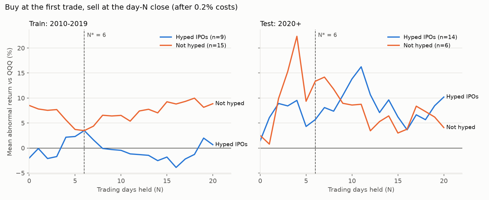

# Do hyped IPOs beat the market if you buy the first trade?

An event study of US IPOs since 2010. If you buy a hyped IPO at its **first public trade** and hold it for N trading days, do you beat the market? Which N works best, and does it hold up on IPOs that were not used to choose it?

The answer counts whether it is yes or no.



## Result (v1, 47 IPOs)

> **Buying hyped IPOs at the first trade and holding for 6 days beat QQQ by +5.7% on average in 2020–2025, but the median IPO lost 2.0% and only 6 of 14 beat the market (p = 0.54).** There is no evidence of an edge in either direction.

- **Training (2010–2019) finds nothing.** The best of the 21 holding periods, N\* = 6, has t = 0.55 (p = 0.60). Across every group, period and N, the smallest p-value is 0.086. Nothing is significant even before correcting for testing 21 values of N.
- **The positive test mean comes from one IPO.** Circle (CRCL) beat QQQ by +94% over 6 days. Without it, the other 13 hyped IPOs average −1.1%.
- **The downside is large.** At N\* = 6, the worst hyped IPO in the test set lost 31% against QQQ, and the 10th percentile was −28.6%.
- **The result holds against SPY.** Mean +6.1%, median −2.3%, t = 0.68. A newly listed stock moves about 7 times more than the market (10-day annualised volatility ~96% vs ~14%), so the choice of benchmark barely matters.
- **The best N is not better than luck.** Correcting for having searched 21 holding periods (a centered bootstrap of the maximum t, Romano–Wolf style, which does not assume symmetric returns), the adjusted p-value for N\* = 6 is **0.61**.
- **The hype label does not separate IPOs.** At N\* in the test period, a two-sided permutation test of hyped vs not-hyped gives p = 0.63.
- **One trade is a coin flip with a fat left tail.** Among hyped test-period IPOs at N\*, 57% lost to QQQ and 21% lost more than 20%. Averaging 10 such trades (resampled) cuts the chance of a >20% relative loss to about 0.1%. That figure assumes the trades are independent, but hot IPOs arrive in waves, so the real risk is higher.
- **The sample is too small to answer the question.** With the observed spread (standard deviation of about 33% at N = 6), detecting a true +5% edge at t ≈ 2 would take roughly 180 hyped IPOs. This version has 9 in training and 14 in test. v2 expands the sample (see [Next steps](#next-steps)).

### At N\* = 6 vs QQQ

| Group | Period | n | Mean | Median | Beat market | t | p | 95% bootstrap CI | Worst | 10th pct |
|---|---|---|---|---|---|---|---|---|---|---|
| Hyped | Train | 9 | +3.5% | +2.8% | 56% | 0.55 | 0.60 | −7.5% to +16.1% | −22.8% | −15.5% |
| Hyped | **Test** | **14** | **+5.7%** | **−2.0%** | **43%** | **0.63** | **0.54** | **−9.5% to +23.8%** | **−31.1%** | **−28.6%** |
| Not hyped | Train | 15 | +3.5% | −4.7% | 40% | 0.48 | 0.64 | −9.9% to +17.9% | −33.3% | −23.5% |
| Not hyped | Test | 6 | +13.4% | +3.8% | 67% | 1.47 | 0.20 | −2.0% to +29.5% | −6.6% | −5.3% |
| Direct listing | Test | 3 | −6.1% | −2.1% | 33% | −0.75 | 0.53 | −21.5% to +5.4% | −21.5% | −17.6% |

The full tables for every N, for both QQQ and SPY, are in [`results/`](results/).

## Method

All rules were fixed and committed **before** looking at any returns.

| Rule | Choice |
|---|---|
| Entry | Open of day 0, the first public trade. Never the offer price, which retail investors rarely get. |
| Exit | Close of day N, for N = 0 to 20 trading days. |
| Costs | 0.2% round trip (commission and slippage), subtracted once from the IPO return. |
| Abnormal return | IPO return minus benchmark return over the same dates. This is the main metric. |
| Benchmark | QQQ (Nasdaq-100). SPY is a robustness check, using the same N\*. |
| Hype | Day-0 open ≥ 1.20 × offer price **and** offer size (offer price × base shares) ≥ US$500M. Both are known when you buy. |
| Train / test | N\* is chosen on 2010–2019 IPOs only, then evaluated on 2020+. It is never re-chosen on test data. |
| Choosing N\* | Highest **t-statistic** of the mean abnormal return for hyped IPOs in training. With few IPOs and very skewed returns, the mean alone would be decided by a single outlier. |
| Statistics | n, mean, median, hit rate, one-sample t-test against 0, and a 95% percentile bootstrap CI (10,000 resamples, seed 42). The worst case and 10th percentile measure downside. |
| Direct listings | Palantir, Roblox and Coinbase form their own group. They have a reference price, not an offer price. |

**Why not day-0 trading volume?** A natural hype signal is first-day dollar volume, but it is only known at the close, while the strategy buys at the open. Using it would be look-ahead bias. Offer size is public before the first trade.

## Data

- **IPO list:** 44 well-known US IPOs (2010–2025), plus SpaceX (SPCX, June 2026) and 3 direct listings. Dates, offer prices, base shares and final price ranges were verified against Renaissance Capital, Nasdaq, Reuters and company pricing releases. See [`data/ipos.csv`](data/ipos.csv).
- **Prices:** daily OHLCV from Yahoo Finance via `yfinance` (`auto_adjust=False`), cached as CSV so every run uses the same data.

### Data problems found and fixed (before looking at returns)

1. **Split-adjusted history.** Yahoo adjusts all past prices for later splits, even with `auto_adjust=False`. Tesla IPO'd at $17 but shows a day-0 open of $1.27 after its 5:1 and 3:1 splits. The offer price is divided by the product of all later splits so both are on the same scale. This also works for reverse splits, such as Groupon's 1-for-20.
2. **Placeholder bars.** On Shopify's pricing day, Yahoo has a bar with all four prices equal to the offer price and zero volume. Left in, it would either look like a reused ticker or become day 0, making the offer price the entry. All zero-volume bars are dropped.
3. **Missing first day.** Yahoo has no bar for Klarna's debut (2025-09-10), so its "day 0" would really be day 1. An IPO is dropped if the market traded between its IPO date and the first available bar. **Klarna is excluded** for this reason.
4. **Reused tickers.** If prices exist before the IPO date, the ticker or date is wrong and the IPO is dropped with a warning. No IPO in v1 triggered this after fix 2.

## Limitations

- **Small sample.** 9 hyped IPOs in training and 14 in test give the tests very little power. This is the main limitation of v1.
- **Selection bias.** The list is made of famous companies, chosen partly because they are memorable. The planned expansion addresses this.
- **Survivorship bias.** Yahoo deletes delisted tickers (e.g. Twitter, LinkedIn), so a broader sample would lose them. None of the 47 IPOs used here is delisted.
- **Multiple testing.** Choosing the best of 21 holding periods favours a lucky N. This is why the test-period result is the one that counts.
- **Arbitrary thresholds.** The 20% and US$500M thresholds were fixed in advance but are not optimised. The US$500M cut-off is nominal, so it is easier to pass in later years.
- **Execution.** Daily data cannot tell at what price an order on a chaotic first day would actually fill.
- **Hot market.** 2020–2021 was an unusually hot IPO market, which may flatter the test period.
- **Benchmark overlap.** SPCX joined the Nasdaq-100 on 2026-07-07, inside its own 20-day window, so QQQ partly contains it on those days.
- **Verification level.** Offer data was cross-checked against several sources, but not prospectus by prospectus.

## Next steps

### v2: a sample of ~2,500 IPOs (built, not yet run)

The pipeline to expand the sample is in place ([`build_sample.py`](build_sample.py), [`src/ipo_study/nasdaq.py`](src/ipo_study/nasdaq.py)). The analysis has not been run on it yet.

- **Source.** Nasdaq's IPO calendar, covering 4,786 priced deals from 2010-01 to 2026-06, cached as raw JSON.
- **Validation before use.** Nasdaq was checked against the 45 hand-verified IPOs:
  - Its `pricedDate` matched the **first trading day in 43 of 43** cases, not the pricing day. One research source had claimed the opposite. Shifting by a day would have silently made every "day 0" the second trading day.
  - Share counts are base shares (42 of 43 within 1%).
  - Offer prices matched in 43 of 43.
  - The exact Nasdaq share counts replaced rounded figures for 8 IPOs in v1. No hype classification changed.
- **Filter.** The filter keeps 2,527 IPOs, 339 of them with an offer of at least US$500M. Every excluded deal has a reason in [`data/excluded.csv`](data/excluded.csv). Nasdaq lists a merged SPAC under its target's *current* name (a SPAC unit appears as "Joby Aviation"), so names cannot identify SPACs. The filter relies on unit tickers instead, plus the $10.00 SPAC price from 2019 on.
- **Survivorship is the main obstacle.** Partway through the price download (1,800 of 2,530 IPOs), about 60% had no Yahoo data, close to 75% for 2010–2012 IPOs. A full v2 should use survivorship-free prices (CRSP via WRDS) and report coverage by year and offer size, which `run_study.py v2` already does.

To finish v2: `python build_sample.py prices` (resumable), then `python run_study.py v2`. The rules stay unchanged and N\* is re-chosen on v2's training period only.

### Prospective case: Anthropic

When it lists, the fixed rule (hype or not, N\*) will be applied and compared with what actually happens. It will not be added to the historical sample.

## Run it

Tested with Python 3.15.

```bash
python3 -m venv .venv
source .venv/bin/activate
python -m pip install -r requirements.txt
python -m pip install -e .
pytest                 # 27 tests, made-up data, no network
python run_study.py    # v1: downloads/caches prices, writes results/

# v2 pipeline (expanded sample)
python build_sample.py download   # Nasdaq IPO calendar, cached as raw JSON
python build_sample.py validate   # compare against the 45 hand-verified IPOs
python build_sample.py filter     # write data/ipos_expanded.csv and data/excluded.csv
python build_sample.py prices     # Yahoo prices for the expanded sample (resumable)
python run_study.py v2            # results/v2/
```

```
data/ipos.csv            IPO list: dates, offer price, base shares, offer size, price range
src/ipo_study/data.py    download and cache prices and splits; data-quality checks
src/ipo_study/events.py  day 0, event window, returns, abnormal returns, volatility
src/ipo_study/analysis.py  hype rule, train/test split, statistics, choice of N*
src/ipo_study/nasdaq.py  download, cache and parse Nasdaq's IPO calendar (v2)
build_sample.py          builds and validates the expanded v2 sample
run_study.py             runs everything and writes tables and charts to results/
tests/                   unit tests with made-up prices
```

## Related work

- Ibbotson & Jaffe (1975), "Hot issue" markets. *Journal of Finance* 30(4).
- Ritter (1984), The "hot issue" market of 1980. *Journal of Business* 57(2).
- Ritter (1991), The long-run performance of initial public offerings. *Journal of Finance* 46(1).
- Loughran & Ritter (1995), The new issues puzzle. *Journal of Finance* 50(1).
- Loughran & Ritter (2004), Why has IPO underpricing changed over time? *Financial Management* 33(3).

---

Piero Pasini · Not investment advice.
