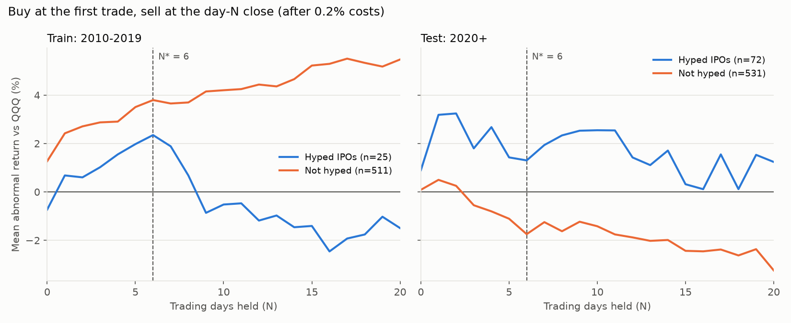
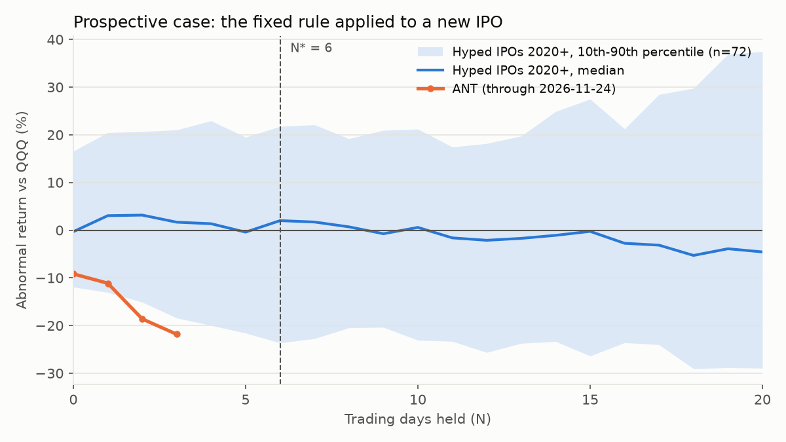

# Do hyped IPOs beat the market if you buy the first trade?

An event study of US IPOs since 2010. If you buy a hyped IPO at its **first public trade** and hold it for N trading days, do you beat the market? Which N works best, and does it hold up on IPOs that were not used to choose it?

The answer counts whether it is yes or no.



<sub>v2 sample. The chart leaves out 31 small, non-hyped IPOs whose Yahoo prices are inconsistently split-adjusted (see [data problems](#data-problems-found-and-fixed)). The hyped line is the same with or without them. [Unscreened chart](results/v2/abnormal_curve_qqq.png).</sub>

## Result

> **Across 1,173 US IPOs from 2010 to 2026, buying hyped IPOs at the first trade and holding for 6 days beat QQQ by +1.3% on average in 2020–2026. The median was +2.0%, and 53% of the 72 trades beat the market (p = 0.58).** There is no edge. With this many trades, the 95% interval (−3.1% to +6.0%) rules out an average edge much larger than about 6%.

- **Training (2010–2019) finds nothing.** The best of the 21 holding periods, N\* = 6, has t = 0.77 (p = 0.45) on 25 hyped IPOs. For hyped IPOs, the smallest p-value across every period and N is 0.09.
- **The best N is not better than luck.** Correcting for having searched 21 holding periods (a centered bootstrap of the maximum t, Romano–Wolf style), the adjusted p-value for N\* = 6 is **0.53**.
- **v1 and v2 agree.** The 47 hand-picked famous IPOs of v1 and the 1,173 IPOs of v2 both choose N\* = 6, and both find no significant edge in test.
- **The positive v1 mean came from one IPO, and v2 confirms it.** Without Circle (CRCL, +94% over 6 days), the 71 other hyped test IPOs average **0.0%**.
- **The hype label does not separate IPOs.** At N\* in the test period, a two-sided permutation test of hyped vs not hyped gives p = 0.66.
- **The result holds against SPY** (mean +1.7%, median +1.5%, t = 0.72) and **without likely foreign issuers** (n = 60, mean +1.7%, t = 0.63). A new listing moves about 5 times more than the market (median 10-day annualised volatility 83% vs 15%), so the benchmark barely matters.
- **One trade is a coin flip with a fat left tail.** Among hyped test IPOs at N\*, 47% lost to QQQ and 12.5% lost more than 20% (5th percentile −28%). In plain money terms, 49% lost money. Averaging 10 such trades (resampled) brings the 5th percentile to −8%. That assumes the trades are independent, but hot IPOs arrive in waves, so the real risk is higher.
- **Not hyped IPOs in training: a likely survivorship artifact, not a finding.** Non-hyped 2010–2019 IPOs beat QQQ by +6.4% (t = 2.2), or +3.8% (t = 3.2) without the suspect prices. This was not the hypothesis, it is one cell among many, and it reverses in test (−1.7%). It also sits exactly where survivorship bias is worst: only about 30% of 2010–2014 IPOs still have Yahoo data, and the ones that survive are the ones that did well.

### At N\* = 6 vs QQQ (v2)

| Group | Period | n | Mean | Median | Beat market | t | p | 95% bootstrap CI | Worst | 10th pct |
|---|---|---|---|---|---|---|---|---|---|---|
| Hyped | Train | 25 | +2.3% | +4.4% | 60% | 0.77 | 0.45 | −3.5% to +8.3% | −28.1% | −16.6% |
| Hyped | **Test** | **72** | **+1.3%** | **+2.0%** | **53%** | **0.56** | **0.58** | **−3.1% to +6.0%** | **−33.6%** | **−23.6%** |
| Not hyped | Train | 516 | +6.4% | +0.3% | 51% | 2.21 | 0.03 | +2.1% to +13.0% | −41.3% | −15.4% |
| Not hyped | Test | 557 | −0.6% | −3.3% | 41% | −0.34 | 0.74 | −3.5% to +3.0% | −88.4% | −31.0% |
| Direct listing | Test | 3 | −6.1% | −2.1% | 33% | −0.75 | 0.53 | −21.5% to +5.4% | −21.5% | −17.6% |

Full tables for every N, for QQQ and SPY, with and without the data screen and foreign issuers, are in [`results/v2/`](results/v2/).

### v1: 47 famous IPOs

The first version used a hand-verified list of 44 well-known IPOs, SpaceX and 3 direct listings. It also chose N\* = 6. Hyped test IPOs averaged +5.7% against QQQ, but the median was −2.0% and p = 0.54. The whole positive mean came from Circle. With 9 hyped IPOs in training and 14 in test it had very little power, which is why v2 was built. Tables and chart: [`results/`](results/).

## Prospective case: Anthropic (ANT)

Anthropic listed on Nasdaq on **2026-11-19** as ANT. It was decided in advance that it would never join the historical sample. Instead, the rule already fixed on past IPOs is applied to it, unchanged, and the outcome is compared with what the study predicted.

| | |
|---|---|
| Offer | $83 (marketed range $70–$78), 980M shares, US$81.3B |
| Day-0 open | $111.50, **+34%** over the offer |
| Hype rule | **Hyped**: open ≥ 1.20 × offer and offer ≥ US$500M |
| Holding period | N\* = 6 (both v1 and v2), so the trade closes at the 2026-11-30 close |
| What the study predicted | No edge: in v2, the median hyped test IPO beat QQQ by +2.0% at N\*, and 53% beat it |
| Status (2026-11-24) | **Pending: 4 of 7 trading days.** At day 3, ANT is **−21.8% vs QQQ** (−24.2% vs SPY), below 66 of the 72 hyped test IPOs on the same day |



`python run_study.py anthropic` recomputes this. It reads N\* and the reference distribution from the saved v1 and v2 results, so nothing is re-chosen after seeing ANT. Until day N\* exists it reports "pending" and does not extrapolate. One IPO cannot confirm or reject the study: it is a check that the rule can be applied as written, with real money at stake.

## Method

All rules were fixed and committed **before** looking at any returns. The one exception is the v2 data-quality screen, which is only a robustness check and is marked below.

| Rule | Choice |
|---|---|
| Entry | Open of day 0, the first public trade. Never the offer price, which retail investors rarely get. |
| Exit | Close of day N, for N = 0 to 20 trading days. |
| Costs | 0.2% round trip (commission and slippage), subtracted once from the IPO return. |
| Abnormal return | IPO return minus benchmark return over the same dates. This is the main metric. |
| Benchmark | QQQ (Nasdaq-100). SPY is a robustness check, using the same N\*. |
| Hype | Day-0 open ≥ 1.20 × offer price **and** offer size (offer price × base shares) ≥ US$500M. Both are known when you buy. |
| Train / test | N\* is chosen on 2010–2019 IPOs only, then evaluated on 2020+. It is never re-chosen on test data. |
| Choosing N\* | Highest **t-statistic** of the mean abnormal return for hyped IPOs in training. With very skewed returns, the mean alone would be decided by a single outlier. |
| Statistics | n, mean, median, hit rate, one-sample t-test against 0, and a 95% percentile bootstrap CI (10,000 resamples, seed 42). The worst case and 10th percentile measure downside. |
| Multiple testing | Centered bootstrap of the maximum t over N = 0..20 (whole IPO curves resampled, 10,000 times). It does not assume symmetric returns. |
| Hype label test | Two-sided permutation test of hyped vs not hyped at N\* in test (10,000 shuffles). |
| Investor risk | Share losing, share losing >20%, 5th/10th percentiles for one trade; averages of k = 3, 5, 10 resampled real trades. No simulated price paths. |
| Direct listings | Their own group. They have a reference price, not an offer price. |

**Why not day-0 trading volume?** A natural hype signal is first-day dollar volume, but it is only known at the close, while the strategy buys at the open. Using it would be look-ahead bias. Offer size is public before the first trade.

## Data

- **v1:** 44 well-known US IPOs (2010–2025), SpaceX (SPCX, June 2026) and 3 direct listings, verified against Renaissance Capital, Nasdaq, Reuters and company releases. See [`data/ipos.csv`](data/ipos.csv).
- **v2:** Nasdaq's IPO calendar, 4,786 priced deals from 2010-01 to 2026-06, filtered to 2,527 IPOs and 3 direct listings. Every exclusion has a reason in [`data/excluded.csv`](data/excluded.csv). Where a deal is also in v1, the hand-verified row is used.
- **Prices:** daily OHLCV from Yahoo Finance via `yfinance` (`auto_adjust=False`), cached as CSV so every run uses the same data.

### How v2 was built and checked

- **Nasdaq vs the hand-verified IPOs.** Offer prices matched in 43 of 43. Share counts are base shares (42 of 43 within 1%). Nasdaq's `pricedDate` matched the **first trading day in 43 of 43** cases, not the pricing day that one research source had claimed. Shifting it by a day would have silently made every "day 0" the second trading day.
- **Filter.** NYSE and Nasdaq only, offer ≥ $5, 2010-01 to 2026-06. Out: SPACs, units, funds, REITs, partnerships, preferreds, mutual bank conversions and direct listings. Nasdaq lists a merged SPAC under its target's *current* name (a SPAC unit appears as "Joby Aviation"), so names cannot identify SPACs. The filter uses unit tickers and the $10.00 SPAC price from 2019 on. EDGAR's SIC codes would be cleaner, but SEC access needs a contact e-mail in the User-Agent.
- **Sample flow.**

| Step | IPOs |
|---|---|
| In the filtered sample | 2,530 |
| No Yahoo data (delisted, merged, renamed) | −1,255 |
| Ticker reused or prices before the IPO date | −52 |
| Only untraded placeholder bars | −5 |
| First trading day missing from Yahoo | −45 |
| **Analysed** | **1,173** |

### Data problems found and fixed

1. **Split-adjusted history.** Yahoo adjusts past prices for later splits, even with `auto_adjust=False`. Tesla IPO'd at $17 but shows a day-0 open of $1.27. The offer price is divided by the product of all later splits so both are on the same scale. This also handles reverse splits.
2. **Placeholder bars.** Yahoo sometimes adds zero-volume bars with every price equal (Shopify's pricing day). All zero-volume bars are dropped. If nothing is left, the IPO is dropped (5 cases in v2, e.g. HIVE 2014, whose ticker now belongs to another company).
3. **Missing first day.** If the market traded between the IPO date and the first available bar, "day 0" would really be day 1, so the IPO is dropped. Klarna (v1) and 45 IPOs in v2 are excluded for this reason.
4. **Reused tickers, part 1.** If prices exist before the IPO date, the ticker or date is wrong and the IPO is dropped (52 in v2).
5. **Reused tickers, part 2 (found running v2).** 26 tickers belong to two different IPOs in v2 (SNOW was Intrawest in 2014 and Snowflake in 2020). Keyed by ticker alone, the later IPO's prices overwrote the earlier one's. Every IPO is now identified by ticker *and* date.
6. **A ticker called "NA".** pandas reads the text `NA` as a missing value by default, which turned Nano Labs' ticker into NaN. Only empty cells are now treated as missing.
7. **Inconsistent adjustments in small IPOs (robustness screen).** Some small IPOs with later reverse splits or ADS-ratio changes come back inconsistently adjusted: Lexin (LX) shows a day-0 open 87% below its offer and then +1,364% in six days. IPOs with a day-0 open more than 3× away from the offer, or a one-day move of more than 3×, are flagged in [`results/v2/suspect_data.csv`](results/v2/suspect_data.csv). This screen was added **after** seeing the v2 extremes, so it is a robustness check and the main tables keep every IPO. It flags 31 IPOs, **all of them non-hyped**, so the hyped results are identical either way.

## Limitations

- **Survivorship bias, the main one.** Half of the v2 sample (1,255 of 2,530) has no Yahoo data, because Yahoo drops delisted tickers. The loss is uneven: 70–86% of 2010–2014 IPOs are missing against under 13% for 2024–2026, and 55% of deals under US$500M against 33% of those above it. The survivors are probably the winners, which is the most likely explanation for the strong not-hyped training result. A survivorship-free source (CRSP via WRDS) would fix this. Coverage by year and size is in [`results/v2/coverage_by_year.csv`](results/v2/coverage_by_year.csv).
- **Multiple testing.** Choosing the best of 21 holding periods favours a lucky N. This is why the test-period result is the one that counts.
- **Arbitrary thresholds.** The 20% and US$500M thresholds were fixed in advance but not optimised. The US$500M cut-off is nominal, so it is easier to pass in later years.
- **Execution.** Daily data cannot tell at what price an order on a chaotic first day would actually fill.
- **Hot market.** 2020–2021 was an unusually hot IPO market, and 43 of the 72 hyped test IPOs are from those two years.
- **Foreign issuers are flagged approximately**, by company-name suffix (Ltd, plc, N.V.…), not by the F-1 form.
- **Benchmark overlap.** SPCX joined the Nasdaq-100 on 2026-07-07, inside its own 20-day window. ANT will raise the same issue if it joins the index.
- **One prospective case.** Anthropic is a single trade. It tests that the rule can be applied as written, not whether it works.

## Next steps

- **Close the Anthropic case** after 2026-11-30 by running `python run_study.py anthropic` again.
- **Survivorship-free prices** (CRSP via WRDS) for the 1,255 IPOs missing from Yahoo.
- **Pre-IPO attention (optional).** News volume in GDELT over the 7 days before day 0, as a secondary variable. It would never redefine the main hype group, and the measure must be written down before it is joined to returns.

## Run it

Tested with Python 3.15.

```bash
python3 -m venv .venv
source .venv/bin/activate
python -m pip install -r requirements.txt
python -m pip install -e .
pytest                          # 31 tests, made-up data, no network
python run_study.py             # v1: downloads/caches prices, writes results/
python run_study.py anthropic   # prospective case, after v1/v2 have run

# v2 pipeline (expanded sample)
python build_sample.py download   # Nasdaq IPO calendar, cached as raw JSON
python build_sample.py validate   # compare against the 45 hand-verified IPOs
python build_sample.py filter     # write data/ipos_expanded.csv and data/excluded.csv
python build_sample.py prices     # Yahoo prices for the expanded sample (resumable, ~1 hour)
python run_study.py v2            # results/v2/
```

```
data/ipos.csv              v1 IPO list: dates, offer price, base shares, offer size, price range
data/ipos_expanded.csv     v2 sample built from Nasdaq's calendar
data/excluded.csv          every excluded Nasdaq deal and why
data/prospective.csv       new IPOs the fixed rule is applied to (Anthropic); never in the sample
src/ipo_study/data.py      download and cache prices and splits; data-quality checks
src/ipo_study/events.py    day 0, event window, returns, abnormal returns, volatility
src/ipo_study/analysis.py  hype rule, train/test split, statistics, N*, robustness, risk
src/ipo_study/nasdaq.py    download, cache and parse Nasdaq's IPO calendar (v2)
build_sample.py            builds and validates the expanded v2 sample
run_study.py               runs everything and writes tables and charts to results/
tests/                     unit tests with made-up prices
```

## Related work

- Ibbotson & Jaffe (1975), "Hot issue" markets. *Journal of Finance* 30(4).
- Ritter (1984), The "hot issue" market of 1980. *Journal of Business* 57(2).
- Ritter (1991), The long-run performance of initial public offerings. *Journal of Finance* 46(1).
- Loughran & Ritter (1995), The new issues puzzle. *Journal of Finance* 50(1).
- Loughran & Ritter (2004), Why has IPO underpricing changed over time? *Financial Management* 33(3).

---

Piero Pasini · Not investment advice.
